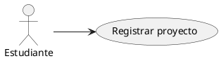

# Informe de Proyecto de Grado — Sistemas de Información III

Repositorio del informe de proyecto de grado de la materia **Sistemas de
Información III**, Carrera de Ingeniería de Sistemas, Universidad Privada
Domingo Savio (UPDS), Sede Potosí.

El documento analiza y propone un **sistema web para la gestión de paquetes
turísticos y reservas en Vizcacha Tours, Potosí**. La clase LaTeX impone el
formato **APA 7.ª edición en español** con los ajustes institucionales
indicados por la cátedra:

| Elemento | Definición |
|---|---|
| Papel | Carta (21,59 × 27,94 cm) |
| Márgenes | Superior 2,54 cm · Inferior 2,54 cm · **Izquierdo 3 cm** · Derecho 2 cm |
| Fuente | Arial 11 pt (o Liberation Sans si Arial no está instalada) |
| Interlineado | 2 |
| Paginado | Esquina inferior derecha; preliminares en romanos y cuerpo en árabes |
| Alineación | Justificada (ajuste solicitado; APA recomienda izquierda) |
| Sangría | Primera línea 1,27 cm; sin espacio adicional entre párrafos |

El contenido corresponde a un perfil de proyecto sobre un sistema web de
gestión de paquetes turísticos y reservas para Vizcacha Tours, Potosí. Cada
sección vive en un archivo propio dentro de `informe/capitulos/`, con su
`\chapter` y su `\label`, para poder editarlas por separado.

## Documentación

- **`documentacion/GUIA-LATEX.md`** — cómo funciona LaTeX, cómo está
  organizada este proyecto, cómo editarlo y cómo compilarlo.
- **`documentacion/INSTALACION-WINDOWS.md`** — instalación completa en
  Windows 11 con winget y Scoop, y compilación con `build.ps1`.
- **`AGENTS.md`** — guía operativa para agentes y modelos que trabajen en el
  repositorio.
- **`documentacion/registro-cambios/`** — bitácora de los trabajos aceptados,
  con el detalle del contenido aplicado en cada uno.

---

## 1. Requisitos e instalación

Todo se instala desde los repositorios oficiales de Arch/Omarchy:

```bash
sudo pacman -S --needed texlive-basic texlive-xetex texlive-binextra \
  texlive-latexrecommended texlive-latexextra texlive-fontsrecommended \
  texlive-fontsextra texlive-langspanish texlive-bibtexextra \
  biber plantuml jre-openjdk librsvg texlab
```

- `texlive-xetex` aporta el motor y el formato de XeLaTeX.
- `texlive-binextra` aporta `latexmk` (compilación incremental).
- `librsvg` aporta `rsvg-convert`, que convierte los diagramas SVG a PDF
  con las **fuentes embebidas**.
- `plantuml` + `jre-openjdk` generan los diagramas UML.

Arial real (opcional, porque ya viene incluida en `ttf-ms-fonts`):

```bash
yay -S ttf-ms-fonts
```

Si Arial no está disponible, la clase usa automáticamente **Liberation
Sans**, que es métricamente idéntica y no altera la paginación.

### Si XeLaTeX indica que falta el formato

```bash
sudo fmtutil-sys --byfmt xelatex
```

Si existe un formato de usuario creado previamente, elimínelo para que se
use el del sistema:

```bash
rm -f ~/.texlive/texmf-var/web2c/xetex/xelatex.fmt
```

---

## 2. Compilación

```bash
make            # genera diagramas, compila y publica el PDF
make pdf        # compila sin regenerar diagramas
make diagramas  # convierte todos los .puml a PDF
make png        # exporta todos los diagramas a PNG en entregables/diagramas/png/
make publicar   # vuelve a copiar el PDF a entregables/ con su nombre definitivo
make verificar  # revisa que los diagramas no tengan participantes sueltos
make ver        # muestra páginas, tamaño y fuentes del PDF
make clean      # borra archivos auxiliares
make distclean  # borra también los diagramas generados y los PNG
```

El PDF se publica en **`entregables/`** con su nombre definitivo:

```
entregables/Informe de Proyecto Formativo - Sistema de Gestión de Paquetes Turísticos y Reservas.pdf
```

El PDF intermedio queda en `_build/main.pdf`, junto a los archivos
auxiliares de compilación. Toda la carpeta `entregables/` es material
generado y **no se versiona**: el PDF se reconstruye desde las fuentes con
un solo `make`.

En Windows, los mismos pasos se ejecutan con `build.ps1`:

```powershell
.\build.ps1              # compila el informe
.\build.ps1 -Diagramas   # genera diagramas y compila
.\build.ps1 -Png         # exporta los diagramas a PNG y compila
.\build.ps1 -Ver         # compila y muestra información del PDF
.\build.ps1 -Limpiar     # borra _build
.\build.ps1 -LimpiarTodo # borra _build, los PDF y los PNG de diagramas
```

### 2.1 Exportación a PNG

`make png` (o `.\build.ps1 -Png`) genera una copia rasterizada de cada
diagrama en **`entregables/diagramas/png/`**, manteniendo la misma estructura de
carpetas que `entregables/diagramas/pdf/`.

- **Resolución:** 300 DPI por omisión. Se cambia con `make png PNG_DPI=600` o
  `.\build.ps1 -Png -Dpi 600`.
- **Fondo:** blanco opaco, sin canal de transparencia, para que las
  imágenes se impriman y se peguen en cualquier documento.
- Los PNG son material derivado para revisión rápida, presentaciones y
  documentación: **no se versionan**, y la carpeta está en `.gitignore`.
- El árbol de problemas, que es un diagrama TikZ y no PlantUML, también se
  exporta; para eso se requiere `pdftoppm` (poppler-utils) en Linux o
  Inkscape o ImageMagick en Windows.

También puede compilar con `latexmk -xelatex main.tex` (respeta
`.latexmkrc`). No use `pdflatex`: la clase exige XeLaTeX o LuaLaTeX porque
carga Arial mediante `fontspec`.

---

## 3. Estructura del proyecto

```
proyecto-formativo/
├── main.tex                 Archivo maestro: orden de todos los archivos
├── si3apa7.cls              Clase: formato, fuentes, márgenes, títulos APA
├── entornos-apa.sty         Entornos: tabla APA, figura APA, cita en bloque
├── latexmkrc                Configuración de latexmk (XeLaTeX + biber)
├── Makefile                 Atajos de compilación y de diagramas (Linux)
├── build.ps1                Compilación y diagramas en Windows
├── AGENTS.md                Guía operativa para agentes y modelos
├── informe/configuracion/
│   ├── metadatos.tex        Título, autor, docente, gestión, etc.
│   └── portada.tex          Portada institucional UPDS y portada APA
├── informe/preliminares/            Resumen
├── informe/capitulos/               Secciones 01 a 11 (06 no incluida)
├── informe/finales/                 Referencias, glosario y llamada a los anexos
├── informe/anexos/                  Anexo A: árbol de problemas (TikZ)
├── informe/                   El contenido del documento
│   ├── configuracion/
│   │   ├── metadatos.tex      Título, autor, docente, gestión, etc.
│   │   └── portada.tex        Portada institucional UPDS y portada APA
│   ├── preliminares/          Resumen
│   ├── capitulos/             Secciones 01 a 11 (06 no incluida)
│   ├── finales/               Referencias, glosario y llamada a los anexos
│   ├── anexos/                Anexo A: árbol de problemas (TikZ)
│   ├── bibliografia/
│   │   └── referencias.bib    Base bibliográfica BibLaTeX
│   └── figuras/
│       ├── logos/             Logotipo institucional
│       └── capturas/          Capturas de pantalla del sistema
├── sistema/                   El sistema que se diseña
│   ├── diagramas/
│   │   ├── uml/               Archivos .puml por tipo de diagrama
│   │   ├── tikz/              Diagramas dibujados directamente en LaTeX
│   │   ├── otros/             DER, arquitectura, mockups (draw.io, etc.)
│   │   ├── ejemplos-plantilla/ Ejemplos heredados, no del proyecto
│   │   └── estilos/           Tema visual de PlantUML
│   ├── base-de-datos/         Esquema SQL y diccionario de datos
│   ├── historias-usuario/     Backlog de historias de usuario (CSV y MD)
│   ├── verificar-uml.py       Comprueba los diagramas de secuencia
│   └── verificar-rutas.py     Comprueba que las rutas existan
├── documentacion/
│   ├── GUIA-LATEX.md          Guía de LaTeX y del proyecto
│   ├── INSTALACION-WINDOWS.md Instalación en Windows 11
│   └── registro-cambios/      Bitácora de los trabajos aceptados
├── entregables/               Lo que se entrega
│   ├── Informe de Proyecto Formativo - Sistema de Gestión de
│   │   Paquetes Turísticos y Reservas.pdf   (PDF final)
│   └── diagramas/             PDF y PNG de los diagramas
├── _build/                    Salida del compilador (se borra sola)
└── .vscode/                   Configuración y extensiones recomendadas
```

---

## 4. Cómo editar el informe

### 4.1 Datos generales

Edite **`informe/configuracion/metadatos.tex`**: título, subtítulo, autor, registro,
docente, gestión, ciudad y fecha de entrega. La portada, los metadatos del
PDF y la bibliografía se actualizan solos.

### 4.2 Secciones principales

Cada archivo de `informe/capitulos/` corresponde a una sección principal del
informe. Estas secciones se numeran y se suceden sin salto de página:

1. Introducción
2. Antecedentes
3. Situación problemática
4. Problema científico
5. Objeto de estudio y campo de acción
6. Objetivos
7. Población y muestra
8. Justificación social
9. Alcances del sistema
10. Límites del proyecto

La antigua sección de variables (`informe/capitulos/06-variables.tex`) ya no se
incluye: la variable dependiente se integra en el problema científico y la
variable independiente en el objetivo general. El árbol de problemas está en
el Anexo A. Cuando el proyecto avance, las secciones de metodología,
desarrollo, resultados y conclusiones se agregan como archivos nuevos sin
alterar el formato.

Para agregar un capítulo, cree el archivo y añada su `\input` en
`main.tex`.

### 4.3 Niveles de título

| Nivel | Comando | Formato |
|---|---|---|
| 1 | `\chapter{...}` | Izquierda, negrita, numerado; sin salto de página |
| 2 | `\section{...}` | Izquierda, negrita |
| 3 | `\subsection{...}` | Izquierda, negrita cursiva |
| 4 | `\subsubsection{...}` | Sangrado, negrita, termina en punto |
| 5 | `\paragraph{...}` | Sangrado, negrita cursiva, termina en punto |

### 4.4 Citas y referencias

```latex
\textcite{huaman2017}               % Huaman Quispe (2017) señala...
\parencite{unescoPotosi}            % ... (Centro del Patrimonio Mundial de la UNESCO, s. f.)
\parencite[p.~45]{huaman2017}       % ... (Huaman Quispe, 2017, p. 45)
```

Las entradas se agregan en `informe/bibliografia/referencias.bib`. El estilo
`biblatex-apa` aplica APA 7, ordena alfabéticamente y usa sangría francesa
de 1,27 cm. En español se usa **«y»** entre autores; si su docente exige el
ampersand original, elimine las declaraciones marcadas en la clase.

Para citas textuales de 40 palabras o más:

```latex
\begin{citalarga}
Texto de la cita, sin comillas, con sangría de 1,27 cm...
\end{citalarga}
```

Para comillas y guiones use los comandos de LaTeX; así se garantiza el
aspecto tipográfico correcto con Arial:

```latex
\enquote{texto entre comillas}      % “texto entre comillas”
un guion \textendash{} corto         % –
un guion \textemdash{} largo         % —
```

### 4.5 Tablas y figuras APA

Tabla: número y título arriba (título en cursiva), líneas horizontales y
nota al pie.

```latex
\begin{tablaapa}{tab:mi-tabla}{Título de la tabla en cursiva}
\begin{tabular}{@{}lcc@{}}
\toprule
Encabezado & A & B \\
\midrule
Dato & 1 & 2 \\
\bottomrule
\end{tabular}
\nota{Elaboración propia con base en \textcite{huaman2017}.}
\end{tablaapa}
```

Figura:

```latex
\begin{figuraapa}{fig:mi-figura}{Título de la figura}
  \incluirDiagrama[0.9\linewidth]{casos-uso/general}
  \nota{Fuente: elaboración propia.}
\end{figuraapa}
```

`\incluirDiagrama{ruta}` busca el PDF en `entregables/diagramas/pdf/`. Si el
archivo no existe, muestra un recuadro de aviso en lugar de romper la
compilación.

---

## 5. Diagramas UML con PlantUML

### 5.1 Crear un diagrama

Cada diagrama es un archivo de texto en `sistema/diagramas/uml/`, dentro de
la carpeta de su tipo:

```
casos-uso/     clases/        objetos/      secuencia/
comunicacion/  actividades/   estados/      componentes/
despliegue/    paquetes/      tiempo/
```

Ejemplo mínimo (`sistema/diagramas/uml/casos-uso/registro.puml`):



En los diagramas de secuencia agregue `hide footbox` después de
`@startuml` para evitar que PlantUML repita los participantes al pie.

### 5.2 Generar los PDF

```bash
make diagramas
```

El `Makefile` aplica el tema `sistema/diagramas/estilos/tema-apa.puml` (Arial 11,
líneas sobrias), genera el SVG y lo convierte a **PDF vectorial con fuentes
embebidas** en `entregables/diagramas/pdf/<tipo>/`.

### 5.3 Insertar en el informe

```latex
\incluirDiagrama[0.95\linewidth]{casos-uso/registro}
```

La ruta es relativa a `entregables/diagramas/pdf/` y **sin extensión**.

### 5.4 Diagramas que no son UML

Para diagramas entidad-relación, arquitectura o prototipos de interfaz
puede usar [draw.io](https://www.drawio.com/) (`sudo pacman -S
drawio-desktop`), exportar a PDF vectorial y guardarlo en
`sistema/diagramas/otros/`. Luego:

```latex
\incluirImagen[0.9\linewidth]{sistema/diagramas/otros/der.pdf}
```

### 5.5 VS Code

Extensiones recomendadas (VS Code las sugerirá al abrir el proyecto):

- **LaTeX Workshop** — compilación y vista previa.
- **PlantUML** — vista previa de los `.puml`.
- **Spanish Language Pack** — interfaz en español.

El proyecto incluye `.vscode/settings.json` con la receta de compilación y
la ruta del `plantuml.jar` de Arch (`/usr/share/java/plantuml/plantuml.jar`).

---

## 6. Opciones de la clase

Se configuran en `main.tex`:

| Opción | Valores | Predeterminado |
|---|---|---|
| `fuente` | `auto`, `arial`, `liberation` | `auto` |
| `alineacion` | `izquierda`, `justificada` | `izquierda` |
| `paginacion` | `institucional`, `apa` | `institucional` |
| `interlineado` | `1.5`, `2` | `1.5` |
| `capitulos` | `romanos`, `arabigos`, `sin` | `romanos` (el proyecto usa `arabigos`) |
| `portada` | `institucional`, `apa`, `ninguna` | `institucional` |

El proyecto usa `alineacion=justificada`, `interlineado=2` y
`capitulos=arabigos`.

Ejemplo para un trabajo con texto justificado y secciones en árabe:

```latex
\documentclass[alineacion=justificada,capitulos=arabigos]{si3apa7}
```

---

## 7. Formato APA 7 aplicado

- Secciones de contenido numeradas y alineadas a la izquierda; referencias,
  glosario y anexos con títulos centrados.
- Tablas y figuras numeradas de forma consecutiva (**Tabla 1**, **Figura 1**),
  con título en cursiva y nota con «*Nota.*».
- Citas parentéticas y narrativas, con «y» entre autores en español.
- Referencias con sangría francesa, orden alfabético y localización
  `spanish-apa` de BibLaTeX.
- Comillas inglesas (“ ”) mediante `\enquote{...}`, como indica la
  adaptación española de APA.
- Citas en bloque sin comillas y con sangría de 1,27 cm.
- Listas con sangría APA y sin espacio adicional entre elementos.
- Paginación inferior derecha y sin encabezado de página.

> Nota: APA 7 original exige doble espacio y márgenes de 2,54 cm en los
> cuatro lados. Esta plantilla mantiene el doble espacio y aplica el margen
> izquierdo de 3 cm para el empastado y la justificación solicitada por la
> cátedra.

---

## 8. Correspondencia con el Reglamento de Graduación de la UPDS

El reglamento institucional organiza el trabajo en pre-texto, cuerpo y
post-texto. Esta plantilla cubre esa estructura y la amplía:

| Reglamento UPDS | Plantilla |
|---|---|
| Pre-texto | Portada, resumen, índices |
| Capítulo I: Marco teórico | Sección 2 (Antecedentes) |
| Capítulo II: Diagnóstico | Sección 3 y Anexo A (árbol de problemas) |
| Capítulo III: Propuesta | Secciones 4 a 10 |
| Post-texto | Referencias, glosario y anexos |

Esta versión corresponde a un **perfil de proyecto** con diez secciones
principales. Cuando se agreguen metodología, desarrollo, resultados y
conclusiones, se crean archivos nuevos en `informe/capitulos/` y se añaden a
`main.tex`; el formato no se altera.

---

## 9. Problemas frecuentes

| Síntoma | Solución |
|---|---|
| `latexmk: command not found` | `sudo pacman -S texlive-binextra` |
| `I can't find the format file 'xelatex.fmt'` | `sudo pacman -S texlive-xetex` y `sudo fmtutil-sys --byfmt xelatex` |
| Aparece «Liberation Sans» en lugar de Arial | `yay -S ttf-ms-fonts` |
| Un diagrama aparece como recuadro de aviso | Ejecute `make diagramas` |
| `Please use CSS style instead of skinparam padding` dentro del diagrama | Ya está corregido en `tema-apa.puml`; no agregue `skinparam padding` |
| El PDF no muestra las referencias | Ejecute `make pdf` (incluye biber) o `biber _build/main` |
| Cambié el título y no se actualiza | Compile dos veces (`make pdf`) para regenerar índices |

---

## 10. Buenas prácticas

- Mantenga el proyecto en Git; `_build/` ya está excluido.
- Escriba una idea por párrafo y cite siempre la fuente.
- No modifique `si3apa7.cls` para cambios de contenido: use las opciones de
  clase o `informe/configuracion/metadatos.tex`.
- Verifique el PDF final con `make ver` antes de imprimir: todas las
  fuentes deben aparecer con `emb = yes`.
