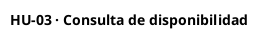

# Diagramas del sistema

Fuentes de los diagramas del sistema de gestión de paquetes turísticos y
reservas. **No forma parte del informe compilado**: es documentación de
trabajo.

Los diagramas se derivan del informe y del backlog, no al revés. Al
editarlos hay que respetar el modelo de este documento.

## Contenido de la carpeta

| Carpeta | Contenido |
|---|---|
| `uml/secuencia/` | Los 10 flujos completos de HU-01, HU-02, HU-03, HU-05, HU-06, HU-07, HU-09, HU-13, HU-14 y HU-15 |
| `uml/secuencia-light/` | Versiones resumidas de esos 10 |
| `uml/secuencia-comunes/` | 5 subflujos reutilizables, sin actor ni interfaz |
| `uml/secuencia-fusionados/` | 2 variantes que combinan historias |
| `uml/estructural/` | Diagramas de clases y de objetos, completos y simplificados |
| `uml/casos-uso/` | Casos de uso con sus `include` y `extend` |
| `uml/procesos/` | Mapa de actividades, flujo del tablero y proceso de estimación |
| `tikz/` | Árbol de problemas del Anexo A |
| `estilos/` | `tema-apa.puml`, el tema visual |
| `otros/` | DER, arquitectura y mockups |
| `ejemplos-plantilla/` | Ejemplos heredados, ajenos al sistema |

## Estereotipos

Los diagramas de secuencia conservan `<<interfaz>>`, `<<control>>`,
`<<entidad>>` y `<<tabla>>`. Los subflujos comunes pueden omitir interfaz y
actor porque son fragmentos técnicos.

## Título

Cada diagrama lleva el título de su historia en la parte superior, con la
palabra clave `title` justo después de `@startuml`:



Las versiones ligeras agregan «(versión ligera)», las fusionadas
«(variante fusionada)» y los fragmentos comunes «Común · …». Los diagramas
estructurales y el de casos de uso usan «Tipo · Descripción».

## Reglas del modelo

- **Dos canales, un proceso.** La consulta, la solicitud de reserva y el
  pago pueden venir del cliente con cuenta (`origen = 'web'`) o del
  personal (`origen = 'personal'`); ambos terminan en la misma validación.
  La solicitud del canal web exige una cuenta de cliente con ficha
  (RN-RES-17) y la firma su cuenta (RN-RES-10).
- **La reserva nace pendiente.** Solo el personal confirma, cancela y
  valida el pago; la confirmación exige el anticipo validado
  (RN-RES-18).
- **Bloqueo transaccional.** Toda validación o modificación de cupos bloquea
  la fila con `SELECT ... FOR UPDATE`.
- **Vencimiento.** Una reserva pendiente vence a las 24 horas y libera
  el cupo.
- **Una solicitud activa** por cliente y salida.
- **La cancelación del cliente es una solicitud** que ejecuta el personal.
- **El pago registrado no es pago validado.** El anticipo no baja del
  30% del total y el saldo paga el resto completo (RN-PAG-01 y
  RN-PAG-05); el cobro web lo emula la pasarela simulada.
- **Los avisos** se emiten cuando cambia la fecha o la capacidad de una
  salida.

## Verificación

`make verificar` ejecuta dos comprobaciones:

- `sistema/verificar-uml.py` revisa los 34 `.puml` de `uml/` y detecta participantes
  usados sin declarar, declarados sin mensajes, entidades o tablas con una
  sola línea de vida, y clases u objetos fuera de toda relación.
- `sistema/verificar-rutas.py` comprueba que las rutas citadas existan y que
  no queden carpetas de una estructura anterior.

Conviene ejecutarlo tras editar un `.puml` o mover carpetas: estos fallos no
rompen la compilación, pero el diagrama se ve mal.

## Generación

```bash
make diagramas   # PDF
make png         # PNG a 300 DPI con fondo blanco
make verificar   # diagramas y rutas
```

En Windows: `.\build.ps1 -Diagramas` y `.\build.ps1 -Png`. Los PDF salen en
`entregables/diagramas/pdf/<tipo>/` y los PNG en
`entregables/diagramas/png/`; no se editan a mano.

El árbol de problemas es TikZ: se compila con XeLaTeX y se rasteriza con
`pdftoppm`.

## Ejemplos heredados

`ejemplos-plantilla/` contiene ejemplos de la plantilla que **no
representan el sistema turístico** (`general`, `modelo-dominio`,
`proceso-evaluacion`, `arquitectura`, `registrar-proyecto`). No se exportan
ni se usan como base sin reemplazarlos por completo.

## Documentos relacionados

- `informe/README.md`: reglas de edición y uso de `\incluirDiagrama`.
- `sistema/historias-usuario/historias-usuario.md`: backlog de referencia.
