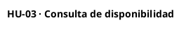

# Diagramas del sistema

Fuentes de los diagramas del sistema de gestión de paquetes turísticos y
reservas. **No forma parte del informe compilado**: es documentación de
trabajo.

Los diagramas se derivan del informe y del backlog, no al revés. Al
redactarlos hay que respetar el modelo que se describe más abajo.

## Contenido de la carpeta

| Carpeta | Contenido |
|---|---|
| `uml/secuencia/` | Los 7 diagramas completos de las HU-03, HU-05, HU-06, HU-07, HU-09, HU-13 y HU-14 |
| `uml/secuencia-light/` | Las versiones resumidas de esos 7 |
| `uml/secuencia-comunes/` | 5 subflujos reutilizables, sin actor ni interfaz |
| `uml/secuencia-fusionados/` | 2 variantes que combinan HU-03 + HU-05 y HU-07 + HU-13 |
| `uml/procesos/` | El mapa de actividades con carriles |
| `tikz/` | El árbol de problemas del Anexo A, dibujado en LaTeX |
| `estilos/` | `tema-apa.puml`, el tema visual de PlantUML |
| `otros/` | DER, arquitectura y mockups |
| `ejemplos-plantilla/` | Ejemplos heredados que no representan el sistema |

## Estereotipos

Los diagramas de secuencia deben conservar los estereotipos:

- `<<interfaz>>`
- `<<control>>`
- `<<entidad>>`
- `<<tabla>>`

Los diagramas comunes pueden omitir interfaz y actor porque son fragmentos
técnicos.

## Título del diagrama

Cada diagrama lleva, en la parte superior y antes de los participantes, el
título de la historia de usuario que representa, en la forma
`HU-NN · Nombre de la historia`. Se declara con la palabra clave `title` de
PlantUML, justo después de `@startuml`:



Las versiones ligeras añaden «(versión ligera)», las variantes fusionadas
«(variante fusionada)» y los fragmentos comunes «Común · …». El título es
único por diagrama y permite identificar la historia de un vistazo, sin
abrir el archivo.

---

## Reglas del modelo que los diagramas deben respetar

- **Dos canales, un proceso.** La consulta, la solicitud de reserva y el
  registro del pago pueden llegar del acceso directo del cliente
  (`origen = 'web'`) o de la atención del personal (`origen = 'personal'`).
  Los dos caminos terminan en la misma validación.
- **La reserva nace pendiente.** Ningún camino confirma por sí solo. La
  confirmación, la cancelación y la validación del pago corresponden al
  personal.
- **El bloqueo transaccional.** Toda validación o modificación de cupos
  bloquea la fila de `salida` o de `reserva` con `SELECT ... FOR UPDATE`.
- **El vencimiento.** Toda reserva pendiente tiene fecha de vencimiento; si
  no se confirma a tiempo, pasa a `vencida` y libera el cupo.
- **Una sola solicitud activa** por cliente y salida.
- **La cancelación del cliente es una solicitud.** El personal la ejecuta.
- **El pago del cliente queda registrado** hasta que el personal lo valida.
- **Los avisos al cliente** se emiten cuando cambia la fecha o la capacidad
  de una salida.

---

## Verificación

`make verificar` ejecuta dos comprobaciones sobre este material.

**`sistema/verificar-uml.py`** revisa los 22 archivos `.puml` del proyecto y
detecta tres fallos:

- un participante usado en un mensaje pero **no declarado**: PlantUML lo
  crea sin estereotipo y en la imagen aparece el texto del alias en lugar
  del icono con su etiqueta;
- un participante declarado que no aparece en ningún mensaje;
- una entidad o una tabla que solo emite o solo recibe, es decir, una línea
  de vida que quedó colgando.

Conviene ejecutarlo después de editar cualquier `.puml`, porque estos fallos
no producen un error de compilación: el diagrama se genera igual, pero se ve
mal.

**`sistema/verificar-rutas.py`** comprueba que las rutas del proyecto
existan y que la documentación no cite carpetas de una estructura anterior.
Conviene ejecutarlo después de cualquier movimiento de carpetas o de cambio
de nombres.

---

## Generación

Los PDF se generan en `entregables/diagramas/pdf/<tipo>/` y los PNG en
`entregables/diagramas/png/`. No editar manualmente esas salidas: se
regeneran desde los `.puml`.

```bash
make diagramas   # PDF
make png         # PNG a 300 DPI con fondo blanco
make verificar   # comprueba los diagramas y las rutas
```

En Windows, los equivalentes son `.\build.ps1 -Diagramas` y
`.\build.ps1 -Png`.

El árbol de problemas es TikZ, no PlantUML: se compila aparte con XeLaTeX en
un documento `standalone` temporal y se rasteriza con `pdftoppm`.

---

## Ejemplos heredados

Estos archivos están en `ejemplos-plantilla/` y son ejemplos de la plantilla
que **no representan el sistema turístico**:

- `general.puml` (casos de uso)
- `modelo-dominio.puml` (clases)
- `proceso-evaluacion.puml` (actividades)
- `arquitectura.puml` (despliegue)
- `registrar-proyecto.puml` (secuencia)

No se exportan a PDF ni a PNG, porque no forman parte de los entregables. No
usarlos como base para el proyecto sin reemplazarlos por completo.

---

## Documentos relacionados

- `informe/README.md`: las reglas de edición del informe, y cómo se incluye
  un diagrama con `\incluirDiagrama`.
- `sistema/historias-usuario/historias-usuario.md`: el backlog al que
  corresponden estas historias de usuario.
