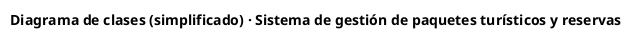

# Diagramas estructurales

Diagramas de clases y de objetos del sistema. No son casos de uso:
describen **cómo está estructurado** el modelo, no el diálogo con el
usuario.

| Archivo | Contenido | Tamaño |
|---|---|---|
| `diagrama-clases.puml` | Modelo completo: 14 clases, 13 enumeraciones, 3 vistas y un servicio | 1549 × 2195 pt |
| `diagrama-clases-simplificado.puml` | Versión publicable: 11 clases, 2 estados y una vista | 1120 × 1136 pt |
| `diagrama-objetos.puml` | Instantánea completa: 20 objetos con sus valores | 1871 × 1432 pt |
| `diagrama-objetos-simplificado.puml` | La misma instantánea con 15 objetos | 1064 × 944 pt |

## Cuál usar

| Situación | Diagrama |
|---|---|
| Publicar como figura | `*-simplificado.puml` |
| Consultar todos los atributos | `diagrama-clases.puml` |
| Ver una instancia completa | `diagrama-objetos.puml` |

Los simplificados son el mismo modelo con menos detalle; al final se indica
qué se quita.

## Diagrama de clases

El modelo sale de `bd/esquema.sql` (tablas, claves y valores permitidos) y
del backlog (`sistema/historias-usuario/historias-usuario.md`, reglas de
negocio).

### Grupos

| Grupo | Clases | Contenido |
|---|---|---|
| Acceso | `Rol`, `Usuario` | Administrador, personal y turista |
| Clientes | `Cliente`, `Pasajero` | Ficha comercial y viajeros |
| Catálogo | `Proveedor`, `Paquete`, `PaqueteProveedor`, `Salida` | Oferta y salidas |
| Operación | `Cotizacion`, `Reserva`, `ReservaPasajero`, `Pago` | Reserva y pagos |
| Auditoría | `HistorialReserva`, `HistorialSalida` | Trazabilidad |
| Consultas | `Disponibilidad`, `Saldo`, `OcupacionPorFecha` | Vistas calculadas |
| Enumeraciones | 13 enumeraciones | Estados y tipos |

`Notificacion` aparece como servicio: avisa al cliente cuando cambia la
fecha o la capacidad de su salida (HU-16).

### Decisiones de modelado

1. **El cupo no se almacena.** `Disponibilidad` se calcula sobre reservas
   `pendiente` y `confirmada`; las `vencida` y `cancelada` no cuentan.
2. **La reserva nace pendiente** en los dos canales. `OrigenReserva`
   distingue `personal` de `web`.
3. **Una sola solicitud activa** por cliente y salida, garantizada por un
   índice único parcial.
4. **La cuenta del cliente es opcional:** `Cliente.idUsuario` admite nulo.
5. **El pago registrado no es el validado.** `Pago.estado` va de
   `registrado` a `validado`.
6. **El saldo se calcula sobre pagos validados.**
7. **La cancelación es lógica:** cambia el estado y guarda motivo y fecha.
8. **La auditoría es explícita:** se guardan el valor anterior y el nuevo.

### Coherencia con los diagramas de secuencia

Los nombres de clases y las operaciones (`bloquearSalida`,
`verificarSolicitudUnica`, `registrarSolicitudCancelacion`,
`calcularSaldo`, `registrarCambio`, etc.) son los mismos que usan los
diagramas de `../secuencia/`.

## Diagrama de objetos

Un diagrama de clases describe el tipo; uno de objetos describe un ejemplar
concreto en un momento concreto. El de este proyecto es una instantánea
coherente del modelo.

> El 10 de noviembre de 2026, a las 10:30, el cliente Luis Mamani acepta la
> cotización `COT-2026-0041` y solicita la reserva `RES-2026-0117` para dos
> personas en la salida del Uros del Titicaca del 12 de diciembre. La
> reserva nace `pendiente`, con vencimiento el 12 de noviembre a las 10:30.
> El cliente registra un anticipo de 500 Bs, en estado `registrado`.

### Historias que cubre

| Historia | Qué aparece |
|---|---|
| HU-15 | `Usuario` vinculado a `Cliente` |
| HU-05 | Cotización emitida y aceptada |
| HU-06 | Reserva pendiente con vencimiento a 48 h |
| HU-12 | Dos pasajeros vinculados |
| HU-14 | Anticipo de 500 Bs registrado y sin validar |
| HU-17 | Espera de confirmación con `fechaExpiracion` |
| HU-16 | Aviso implícito de la reserva pendiente |

### Los valores cuadran

| Comprobación | Resultado |
|---|---|
| `fechaExpiracion` − `fechaReserva` | 48 horas |
| `cantidadPasajeros` | 2, con 2 vínculos en `ReservaPasajero` |
| `cupoDisponible` | 12 − 2 = 10 |
| `cupoDisponibleSinPendientes` | 12, porque sigue pendiente |
| `totalValidado` | 0 |
| `saldoPendiente` | 1780 |

El anticipo existe, pero mientras el personal no lo valide no reduce el
saldo ni confirma la reserva.

## Qué se quita en los simplificados

| Simplificación | Clases | Objetos |
|---|---|---|
| Atributos | Solo los que sostienen una regla | Solo los que se leen |
| Operaciones | Una o dos por clase | No se muestran |
| Enumeraciones | `EstadoReserva` y `EstadoPago` | No hay |
| Vistas | `Disponibilidad` | `Disponibilidad` y `Saldo` |
| Clases fuera | `Rol`, `Proveedor`, `PaqueteProveedor`, `HistorialReserva`, `HistorialSalida`, `Notificacion` | `Rol`, `Proveedor`, `PaqueteProveedor`, `HistorialReserva` |
| Notas | Dos | Cuatro |

Lo que se quita sigue en `bd/esquema.sql` y en el diagrama completo.

## Título y generación

Los cuatro llevan su título con `title` justo después de `@startuml`:



```powershell
.\build.ps1 -Diagramas
```

Los PDF quedan en `entregables/diagramas/pdf/estructural/` y los PNG en
`entregables/diagramas/png/`.
