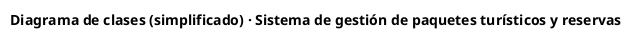

# Diagramas estructurales

Diagrama de clases y diagrama de objetos del sistema de gestión de paquetes
turísticos y reservas. No son casos de uso: describen **cómo está
estructurado** el modelo, no el diálogo con el usuario.

| Archivo | Contenido | Tamaño |
|---|---|---|
| `diagrama-clases.puml` | Modelo de dominio completo: 14 clases, 13 enumeraciones, 3 vistas y un servicio. | 1549 × 2195 pt |
| `diagrama-clases-simplificado.puml` | El mismo modelo reducido a lo publicable: 11 clases, 2 estados y una vista. | 1120 × 1136 pt |
| `diagrama-objetos.puml` | Instantánea completa del sistema, con 20 objetos y todos sus valores. | 1871 × 1432 pt |
| `diagrama-objetos-simplificado.puml` | La misma instantánea reducida a 15 objetos. | 1064 × 944 pt |

## Cuál usar

| Situación | Diagrama |
|---|---|
| Publicar como figura en el informe | `*-simplificado.puml` |
| Consultar el modelo con todos sus atributos | `diagrama-clases.puml` |
| Ver una instancia con todos sus valores | `diagrama-objetos.puml` |

Los simplificados no son un modelo distinto: son el mismo modelo con menos
detalle. Lo que se quita y lo que se conserva está al final de este
documento.

---

## Diagrama de clases

El modelo sale de dos fuentes que deben coincidir con él:

- `sistema/base-de-datos/esquema-temporal.sql`, que fija las tablas, las
  claves y los valores permitidos;
- `sistema/historias-usuario/historias-usuario.md`, que fija las reglas de
  negocio.

### Grupos

| Grupo | Clases | Contenido |
|---|---|---|
| «Acceso» | `Rol`, `Usuario` | Tres roles: administrador, personal de agencia y turista. |
| «Clientes» | `Cliente`, `Pasajero` | Ficha comercial y personas que viajan. |
| «Catalogo» | `Proveedor`, `Paquete`, `PaqueteProveedor`, `Salida` | Oferta, servicios incluidos y salidas programadas. |
| «Operacion» | `Cotizacion`, `Reserva`, `ReservaPasajero`, `Pago` | Propuesta económica, reserva y pagos. |
| «Auditoria» | `HistorialReserva`, `HistorialSalida` | Trazabilidad de los cambios. |
| «Consultas» | `Disponibilidad`, `Saldo`, `OcupacionPorFecha` | Vistas de lectura: no se almacenan, se calculan. |
| «Enumeraciones» | 13 enumeraciones | Estados y tipos permitidos. |

`Notificacion` aparece como servicio: avisa al cliente cuando cambia la
fecha o la capacidad de su salida (HU-16).

### Decisiones de modelado

1. **El cupo no se almacena.** `Disponibilidad` es una vista: se calcula
   sobre las reservas `pendiente` y `confirmada`. Las `vencida` y las
   `cancelada` no cuentan, de modo que liberan el cupo por cálculo.
2. **La reserva nace pendiente.** En los dos canales. `OrigenReserva`
   distingue `personal` de `web`, y el estado `pendiente` lleva siempre una
   `fechaExpiracion`.
3. **Una sola solicitud activa por cliente y salida.** Lo garantiza un
   índice único parcial, no una clase.
4. **La cuenta del cliente es opcional.** `Cliente.idUsuario` admite valor
   nulo: un cliente sin cuenta sigue siendo atendido por el personal.
5. **El pago registrado no es el pago validado.** `Pago.estado` va de
   `registrado` a `validado`, y `idUsuarioValidacion` es la prueba de que
   el personal lo revisó.
6. **El saldo pendiente se calcula sobre los pagos validados.** Un pago solo
   registrado por el cliente todavía no se considera cobrado.
7. **La cancelación es lógica.** `Reserva` cambia de estado y guarda el
   motivo y la fecha; el registro no se elimina.
8. **La auditoría es explícita.** `HistorialReserva` y `HistorialSalida`
   guardan el valor anterior y el nuevo de cada cambio.

### Coherencia con los diagramas de secuencia

Los nombres de las clases son los mismos que usan los diagramas de
`../secuencia/` como entidades: `Cliente`, `Cotizacion`, `Paquete`,
`Salida`, `Reserva`, `ReservaPasajero`, `Pasajero`, `Pago`,
`HistorialReserva`, `HistorialSalida` y `Notificacion`.

Las operaciones son las mismas que aparecen en los mensajes de esos
diagramas (`bloquearSalida`, `verificarSolicitudUnica`,
`registrarSolicitudCancelacion`, `calcularSaldo`, `registrarCambio`, etc.),
de modo que el modelo y los flujos no se contradicen.

---

## Diagrama de objetos

### Qué es y qué no es

Un diagrama de clases describe **el tipo**; un diagrama de objetos describe
**un ejemplar concreto en un momento concreto**. No puede ser general: si
mostrara todos los clientes posibles, todas las reservas posibles y todos
los estados a la vez, dejaría de ser un diagrama de objetos y sería un
diagrama de clases disfrazado, o una tabla.

Lo que sí puede —y es lo que hace el diagrama— es **ilustrar el modelo con
un caso coherente y real**, de modo que se vea cómo funcionan las reglas
con valores de verdad. El de este proyecto es una «instantánea».

### La instantánea

> El 10 de noviembre de 2026, a las 10:30, el cliente Luis Mamani acepta la
> cotización `COT-2026-0041` y solicita la reserva `RES-2026-0117` para dos
> personas en la salida del Uros del Titicaca del 12 de diciembre de 2026.
> La reserva nace `pendiente`, con vencimiento el 12 de noviembre a las
> 10:30 (48 horas después). El cliente registra un anticipo de 500 Bs por
> transferencia, que queda en estado `registrado`.

### Qué historias cubre

El escenario principal es **HU-06** (registro de reserva con validación de
cupos) y **HU-14** (registro de anticipo). Toca de paso otras:

| Historia | Qué aparece en la instantánea |
|---|---|
| HU-15 | La cuenta del cliente: `Usuario` vinculado a `Cliente` |
| HU-05 | La cotización `COT-2026-0041`, emitida por el personal y aceptada |
| HU-06 | La reserva `RES-2026-0117` naciendo `pendiente`, con vencimiento a 48 h |
| HU-12 | Los dos pasajeros vinculados a la reserva |
| HU-14 | El anticipo de 500 Bs, `registrado` y **no** validado |
| HU-17 | La reserva a la espera de confirmación, con `fechaExpiracion` |
| HU-16 | Implícita: la reserva pendiente es la que dispara el aviso al cliente |

Se eligió este caso y no otro porque es el que muestra mejor las tres
reglas que sostienen el proyecto: la reserva nace pendiente en los dos
canales, el cupo no se almacena y el pago registrado no es el validado.

### Los valores cuadran entre sí

| Comprobación | Resultado |
|---|---|
| `fechaExpiracion` − `fechaReserva` | 48 horas, el plazo por omisión del esquema |
| `cantidadPasajeros` de la reserva | 2, y hay 2 vínculos en `ReservaPasajero` |
| `cupoDisponible` de la salida | 12 − 2 = 10 lugares libres |
| `cupoDisponibleSinPendientes` | 12, porque la reserva sigue pendiente |
| `totalValidado` del saldo | 0, porque el anticipo no está validado |
| `saldoPendiente` del saldo | 1780, el total de la reserva |

Ese último punto resume la regla del sistema: el anticipo existe y está
registrado, pero mientras el personal no lo valide no reduce el saldo
pendiente ni confirma la reserva.

---

## Qué se quita en las versiones simplificadas

No se cambia el modelo: se cambia cuánto se enseña de una vez.

| Simplificación | Diagrama de clases | Diagrama de objetos |
|---|---|---|
| Atributos | Se deja solo los que sostienen una regla | Se deja solo los que se leen en la figura |
| Operaciones | Una o dos por clase | No se muestran: los mensajes son de los diagramas de secuencia |
| Enumeraciones | Solo `EstadoReserva` y `EstadoPago` | No hay: los valores van en el atributo |
| Vistas de lectura | Solo `Disponibilidad` | `Disponibilidad` y `Saldo` |
| Clases fuera | `Rol`, `Proveedor`, `PaqueteProveedor`, `HistorialReserva`, `HistorialSalida`, `Notificacion` | `Rol`, `Proveedor`, `PaqueteProveedor`, `HistorialReserva` |
| Notas | Dos: la de la reserva y la de la disponibilidad | Cuatro: una por hecho relevante |

Lo que se quita del diagrama de clases no se pierde: sigue en el esquema
SQL, que es la fuente de verdad del modelo, y en el diagrama completo.

---

## Título

Los cuatro diagramas llevan su título en la parte superior, con la palabra
clave `title` de PlantUML, justo después de `@startuml`:



## Generación

```powershell
.\build.ps1 -Diagramas
```

Los PDF quedan en `entregables/diagramas/pdf/estructural/` y los PNG en
`entregables/diagramas/png/`.
